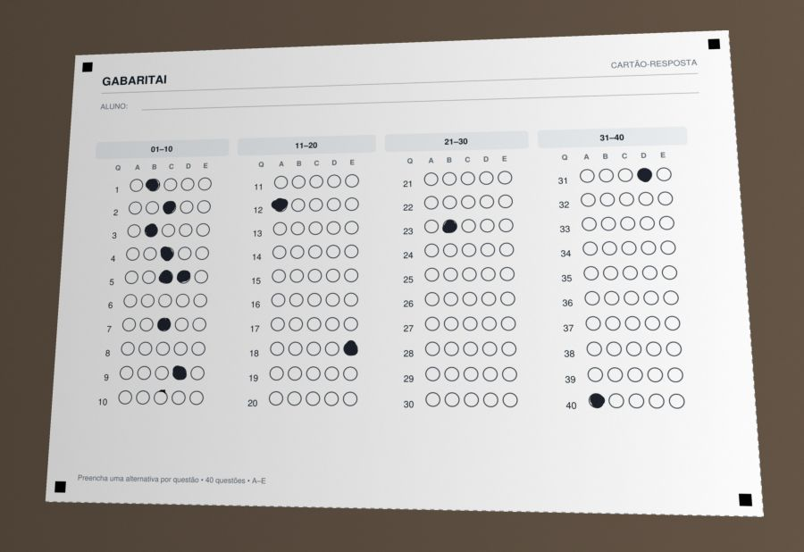
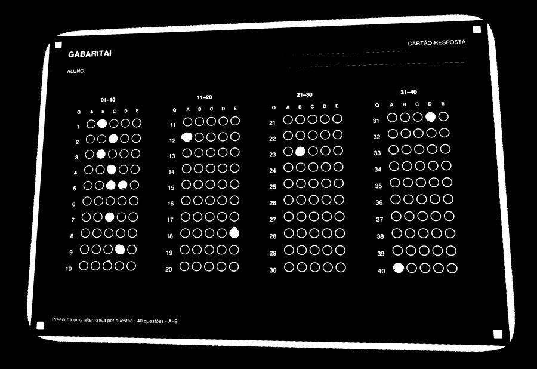
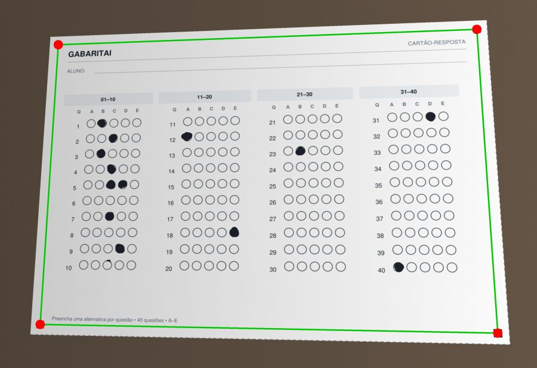
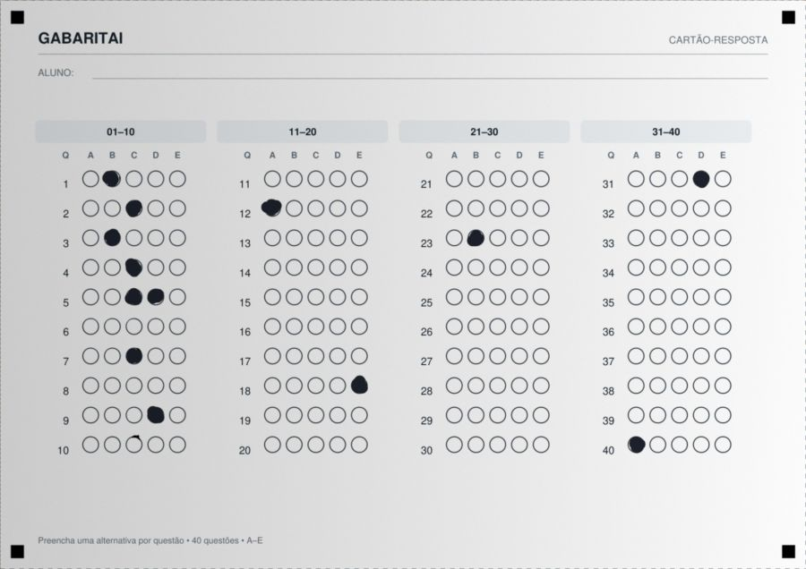
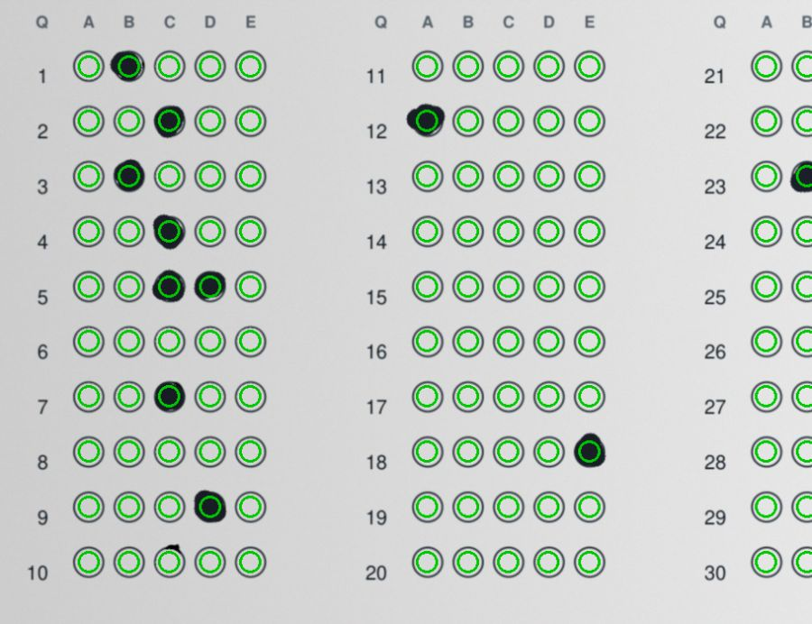
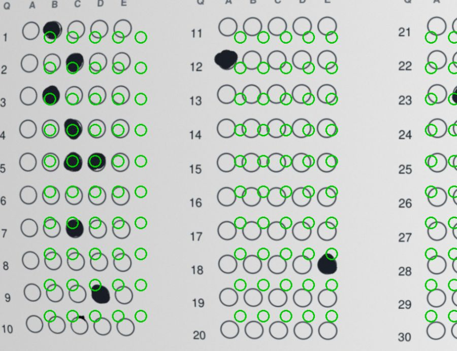
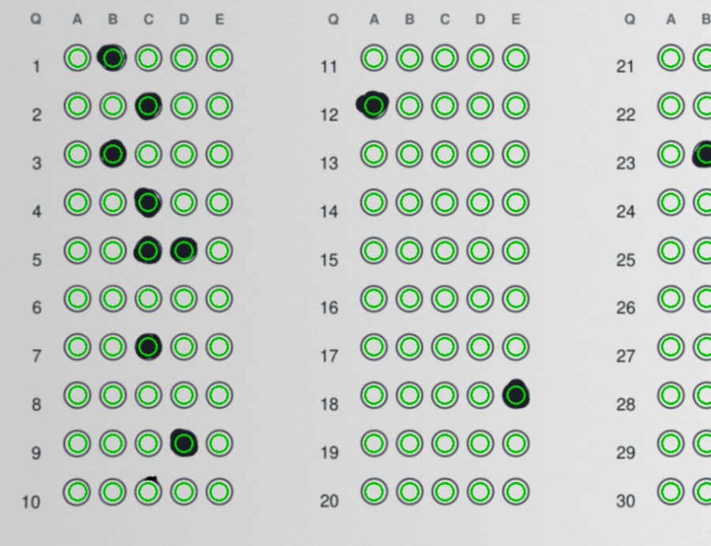

# Como o computador lê um cartão-resposta

Mini aula sobre o leitor do GabaritAI. Não precisa instalar nada: é só ler.

Para o computador, uma foto é só uma tabela de números. O objetivo é transformar
esta foto em uma lista de respostas:



Vamos resolver um problema de cada vez.

## 1. Deixar a imagem só em preto e branco

**Problema:** tem sombra, papel, mesa... cores demais.

**Ideia:** cada ponto vira branco (tinta) ou preto (fundo). Cada ponto é comparado
com a vizinhança, por isso a sombra não atrapalha.



```python
cv2.adaptiveThreshold(...)
```

## 2. Achar os quatro quadrados

**Problema:** onde o cartão está na foto?

**Ideia:** listar as formas da imagem e ficar com as que têm 4 pontas e são pretas.
O cartão tem esses quadrados nos cantos justamente para facilitar isso.



```python
cv2.findContours(...)
```

## 3. Desentortar

**Problema:** cada foto vem de um ângulo. A bolha nunca está no mesmo lugar.

**Ideia:** sabemos onde os cantos estão na foto e onde deveriam estar no cartão modelo.
Com esses 4 pares, a foto é "esticada" até ficar igual ao modelo. A partir daqui,
a posição de cada bolha é um número fixo.



```python
matriz = cv2.getPerspectiveTransform(cantos_na_foto, cantos_no_modelo)
pagina = cv2.warpPerspective(foto, matriz, (1684, 1191))
```

## 4. Medir cada bolha

**Problema:** como saber se uma bolha está pintada?

**Ideia:** olhar só o miolo de cada bolha (círculos verdes) e calcular quanto dele
tem tinta. 0% é vazia, 100% é cheia.



## 5. Decidir a resposta

**Problema:** porcentagem não é resposta. Precisamos de regras, nesta ordem:

| Situação | Resultado |
|---|---|
| Nenhuma bolha passou de 30% | Em branco |
| Duas ou mais passaram de 30% | Anulada, como no vestibular |
| A maior é só um pouco maior que a segunda | Dúvida: o professor confere |
| Senão | A maior é a resposta |

Nesta foto, a questão 5 tem C e D pintadas, então é anulada.

## 6. O problema da webcam real

Até aqui, tudo funciona na teoria. Na webcam, a lente **curva** a imagem. Os quatro
cantos ficam certos, mas o miolo do cartão sai do lugar. Veja os círculos verdes
fora das bolhas:



A questão 1 foi lida como A, mas a marca está na B.

**Ideia:** o cartão já tem 200 pontos de referência: os círculos impressos.

1. Achamos onde cada círculo está de verdade.
2. Comparamos com onde ele deveria estar.
3. Calculamos uma curva que explica a diferença.
4. Usamos a curva para endireitar a imagem.



**Lição:** o que funciona na foto perfeita pode falhar no mundo real. Teste com a
câmera de verdade o quanto antes.

## 7. Como isso entra no sistema

O leitor é só uma parte. O caminho completo é:

```text
Tela (respostas.html)  tira a foto da webcam
        |  POST /leituras
API  salva a foto e cria um "job" na tabela processing_jobs
        |
Worker  pega o job, roda o leitor e grava o resultado no job
        |  GET /leituras/{id}  (a tela pergunta até ficar pronto)
Tela  preenche o formulário; o professor confere e salva
```

- **Por que um worker?** Ler imagem é pesado. A API responde na hora e a leitura
  acontece em outro processo.
- **Por que o professor confere?** Foto ruim acontece. O leitor sugere, a pessoa decide.

## Onde ver no código

Tudo está em `backend/app/worker/vision/omr_engine.py`, no projeto GabaritAI:

| Etapa | Função |
|---|---|
| 1 e 2 | `find_markers` |
| 3 | `rectify_page` |
| 4 e 5 | `read_bubbles` |
| 6 | `align_to_printed_bubbles` |

Para ver a leitura ao vivo, rode `python ver_leitura.py` na pasta `backend`.

## Para praticar

1. Por que medimos só o miolo da bolha, e não ela inteira?
2. O que aconteceria se o limite de 30% baixasse para 10%?
3. Por que o cartão precisa de quatro quadrados, e não de dois?
